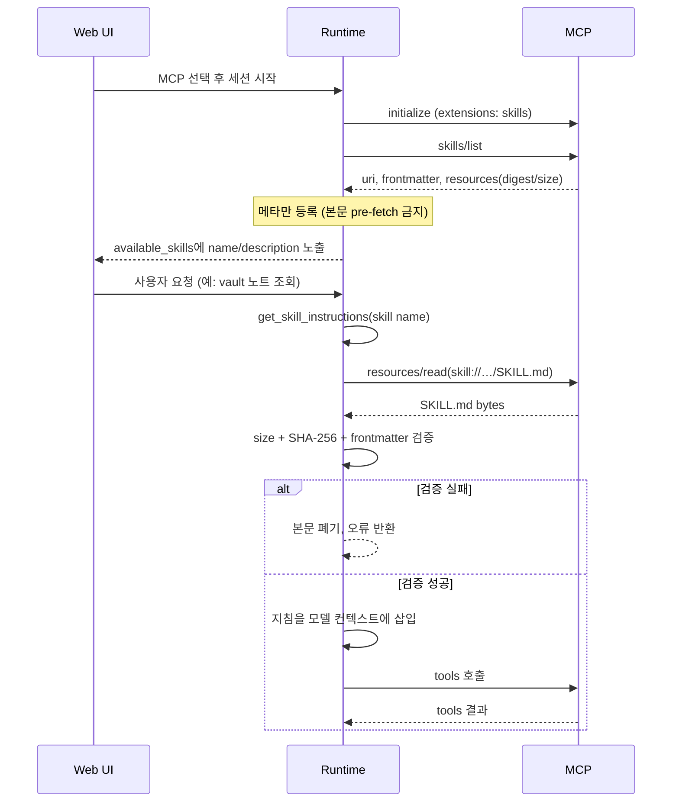

# Skills over MCP

use-vault MCP에 Agent Skills를 실어 보내고, agentic-work Runtime이 이를 소비하는 설계·구현 문서입니다.

스펙 배경: [Skills-over-MCP 란?](https://vault.my-agentic-ai.click/s/uSe3Cs_Q5drQUICrc9e0Bb5f) · [skills/overview](https://modelcontextprotocol.io/extensions/skills/overview)

관련 코드:

- 서버: `ob-note/MCP/use-vault/` (`vault_skills.py`, `skills/use-vault/SKILL.md`)
- 클라이언트: `runtime_agent/langgraph/mcp_skills.py`, `skill.py`, `chat.py`
- 이전 로컬 스킬 `runtime_agent/langgraph/skills/my-vaults/` 는 **삭제됨** (2절은 이력)

---

## 목차

1. [Skills over MCP란](#1-skills-over-mcp란) — 개념 · 스펙 · 무결성/보안
2. [my-vaults가 어떻게 동작했는지](#2-my-vaults가-어떻게-동작했는지-통합-전) — 통합 전 이력
3. [통합 설계](#3-통합-설계-skills-over-mcp) — use-vault + agentic-work 구현
4. [SEP-2640 대비 갭 검토](#4-sep-2640-대비-갭-검토)
5. [검증 체크리스트](#5-검증-체크리스트)

---

## 1. Skills over MCP란

### 1.1 한 줄과 동기

MCP 서버가 도구와 함께 **Agent Skill**(`SKILL.md` + 지원 파일)을 게시하고, 클라이언트가 필요할 때만 지침을 읽어 모델 컨텍스트에 넣는 공식 확장입니다.

기존 MCP는 “툴 이름/설명”으로 *무엇을 할 수 있는지*만 알려 주었습니다. Skills over MCP는 서버가 *특정 작업을 어떻게 처리할지*에 대한 **워크플로 지침**까지 함께 배포합니다.

도구 이름만으로는 multi-step 워크플로(폴더 규약, 문체, deep link, 이미지·`vault_upload` 규칙 등)를 담기 어렵습니다. Skill을 서버에 두면:

- 도구와 지침이 **함께 배포·갱신**됩니다
- 호스트는 description만 먼저 보고, 필요할 때 `SKILL.md`를 로드합니다 (**progressive disclosure**)
- 사용자/에이전트마다 로컬 skill 복사본을 유지하지 않아도 됩니다

업계 예시: Shopify(스토어 디자인), HubSpot(온보딩), Atlassian(업무 인사이트), Carta(지분 서류 초안, 예정).  
Claude / Claude Code에 퍼블릭 베타로 노출되었고, Pro/Max/Ultra는 기본 활성 · Team은 관리자 활성 · Enterprise는 출시 예정입니다.

### 1.2 스펙 요약

| 항목 | 값 |
| --- | --- |
| SEP | [SEP-2640](https://modelcontextprotocol.io/seps/2640-skills-extension) (**Final**) |
| Extension id | `io.modelcontextprotocol/skills` |
| Working Group | [ext-skills](https://github.com/modelcontextprotocol/ext-skills) |
| Overview | [skills/overview](https://modelcontextprotocol.io/extensions/skills/overview) |
| Skill 패키지 형식 | [Agent Skills](https://agentskills.io/specification) (MCP는 **전송·발견·무결성**만 정의) |

#### Capability (필수)

서버는 `resources`와 skills 확장을 반드시 선언합니다(MUST). use-vault는 `directoryRead: false`입니다.

```json
{
  "capabilities": {
    "resources": {},
    "extensions": {
      "io.modelcontextprotocol/skills": {
        "directoryRead": false
      }
    }
  }
}
```

- 선언 시 `skills/list` · `skills/get` 구현과 `resources/read`로 스킬 파일 제공이 필수
- `directoryRead`(기본 `false`): `resources/directory/read` 지원 여부. 빈 객체 `{}`도 “디렉터리 읽기 없이 지원”
- 클라이언트는 capability 확인 후에만 skills 메서드를 호출

#### 프로토콜 메시지

| 메서드 | 역할 |
| --- | --- |
| `skills/list` | 카탈로그. entry마다 `uri` · `frontmatter`(YAML 전체) · `resources` manifest(URI + SHA-256 digest + size). envelope: `resultType` · `ttlMs` · `cacheScope` |
| `skills/get` | URI 단건 조회·갱신. listing에 없어도 직접 조회 가능해야 함 |
| `resources/read` | `SKILL.md` / 부속 파일 바이트 |
| `resources/directory/read` | (옵션) `directoryRead: true`일 때만 |

- `skills/list` entry는 **완전(complete)** 해야 함 — 추가 메타를 위해 `skills/get`을 또 칠 필요 없음
- `ttlMs`/`cacheScope`는 신선도·공유 범위만 설명하며 **콘텐츠 무결성을 보장하지 않음**
- `resources/read`로 `SKILL.md`를 읽는 행위 자체는 스킬을 **활성화하지 않음** — 호스트의 로딩 경로(검증·승인)를 거쳐야 함
- `directoryRead` 사용 시, 실시간 디렉터리 결과를 보유 manifest의 확장으로 취급하거나 새 파일을 그 스킬 일부로 노출하면 안 됨(MUST NOT)

#### Skill 패키지 규칙

- Skill = `SKILL.md` + (선택) 부속 파일 디렉터리
- YAML frontmatter 필수: `name`, `description`
- **상위 폴더명의 마지막 세그먼트 = `name`** (예: `skills/use-vault/` → `name: use-vault`)
- 상대경로 참조는 스킬 루트 기준 (예: `references/a.md` → `skill://use-vault/references/a.md`)
- 발견·조회는 기존 **Resources** 프리미티브를 그대로 사용

#### Identity

식별자는 skill **이름만**이 아니라 **(원 서버 identity + skill URI)** 입니다.

- 이름은 label일 뿐 고유성이 보장되지 않음
- 호스트는 승인·캐시·레지스트리에 서버 identity와 URI를 함께 보존(MUST)
- 서버는 `skill://` 스킴을 SHOULD로 쓰지만 다른 스킴도 MAY
- 호스트는 URI 스킴만으로 “스킬”이라고 식별하면 안 됨(MUST NOT)

### 1.3 Progressive disclosure와 메시지 흐름

연결·목록 단계에서는 메타(이름·설명·digest)만 주고, 본문(`SKILL.md`)은 에이전트가 그 skill이 필요할 때만 읽습니다. 호스트는 읽은 바이트를 listing의 digest/size/frontmatter와 대조한 뒤에야 모델 컨텍스트에 넣습니다.

> Hosts MUST NOT retrieve files ahead of need, including on connection, listing, or approval.  
> 연결·리스팅·승인 시점에 파일을 미리 당겨오는 것 자체가 금지됩니다. 승인은 파일을 가져오기 **전**에 manifest 기준으로만 합니다.



| 단계 | 누가 | 무엇을 |
| --- | --- | --- |
| 1. 연결 | Host ↔ MCP | `initialize`로 skills extension 확인 |
| 2. 발견 | Host → MCP | `skills/list` — 카탈로그·매니페스트만 |
| 3. 노출 | Host → 모델 | system prompt에 **description**만 (`<available_skills>`) |
| 4. 필요 시 로드 | 모델 → Host | `get_skill_instructions` |
| 5. 본문 조회 | Host → MCP | `resources/read(uri)` |
| 6. 검증 | Host | size · digest · frontmatter 일치 시에만 사용 |
| 7. 실행 | 모델 → MCP | skill 지침에 따라 tools 호출 |

스펙 sequence(요약):

```text
[사전] Host → skills/list → frontmatter + manifest
      Host → Model/User: 사용 가능 스킬 + origin 안내
[선택] Model/User가 (server, URI) 선택
[URI만] Host → skills/get(URI)  (실패 시 -32602, 로딩 중단)
Host: entry를 (server, URI)로 retain
[승인 필요 시] manifest 기준 승인 (파일 pre-fetch 금지)
Host → resources/read(SKILL.md) → size/digest/frontmatter 검증
Host → Model: 검증된 지침 + origin 태그
[반복] 부속 파일: manifest URI만 허용 → read → digest 검증 → origin 태그
```

알려진 URI는 listing 없이도 로드할 수 있고, listing entry가 있으면 재사용합니다. 모든 스킬 읽기는 **원 서버**를 통해서만 합니다. 조회 실패·승인 거부·검증 실패 시 콘텐츠를 쓰지 않습니다.

관통하는 원칙:

1. Progressive disclosure — 메타 먼저, 본문은 필요할 때만
2. Digest = **일치성(consistency)**, **신뢰(trust)가 아님**
3. Identity = 서버 + URI
4. 승인(파일셋 바인딩) — 파일 추가·변경·삭제 시 기존 승인 즉시 무효

### 1.4 무결성 · `"dynamic"` · 보안 · 에러 · 서버 제약

**무결성 (호스트 MUST)**

- skill을 쓰는 동안 entry를 retain (최소 `SKILL.md`가 컨텍스트에서 나갈 때까지)
- 파일 읽기는 **보유 manifest의 URI로만** 제한
- 사용 전 **원본 바이트 size + SHA-256 digest** 검증
- `SKILL.md` frontmatter를 파싱해 entry frontmatter와 **필드 단위** 대조
- 실패 콘텐츠는 사용 금지. 메타가 오래되면 `skills/get`으로 entry 갱신
- persisted approval은 **전체 URI+digest 세트**에 묶임 → 파일 변경 시 즉시 revoke 후 재승인
- 디스크 캐시(SHOULD): immutable 유지 또는 매 접근 재검증; FS 기반 스킬 탐색 경로에서 제외; 재시작 후에도 MCP origin 보존

> Digest establishes consistency with the server's manifest, not trust in its content.  
> (digest는 manifest와의 **일치성**만 보장하며, 콘텐츠 **신뢰**를 보장하지 않음)

**`"dynamic"` 리소스**

- 안정 digest가 없는 생성 콘텐츠는 manifest에 `"dynamic"`으로 표시
- 호스트는 거부해도 됨(MAY). 수용해도 frontmatter는 검증하고, 저장 승인이 이후 임의 콘텐츠를 커버한다고 보면 안 됨

**보안 (호스트 MUST)**

- 동명 skill의 silent replace 금지
- 로드 콘텐츠에 **출처 서버 태그**; 리소스 읽기를 그 서버에 바인딩. **cross-server read**는 두 서버를 명시한 per-call 승인 필요
- 스킬 본문을 **untrusted input**으로 취급. 호스트 코드 실행·`allowed-tools` 등은 스킬별 명시 승인
- **중첩 스킬** 활성화 전 별도 동의 — 다른 스킬의 부속으로 `SKILL.md`를 읽은 것만으로 중첩 skill이 자동 활성화되지 않음

**에러**

| 상황 | 처리 |
| --- | --- |
| 알 수 없는 스킬/파일, 잘못된 디렉터리 URI | JSON-RPC `-32602` Invalid params |
| 서버 내부 오류 | JSON-RPC `-32603` Internal error |
| digest/size/frontmatter/manifest 불일치 | 프로토콜 에러 아님 — 호스트가 콘텐츠 거부 + entry refresh |

**서버 제약 (MUST / SHOULD)**

- 유효한 Agent Skills + 선언한 메서드(Resources 포함) 구현
- frontmatter 필드 보존 + 실제 바이트로 계산한 **완전한** manifest (`"dynamic"` 예외)
- listing과 독립된 직접 조회; entry는 atomic (manifest가 페이지에 쪼개지면 안 됨)
- SHOULD NOT: 스킬당 **512파일 · 16MiB** 초과 (`SKILL.md` 포함). 호스트는 이 한도까지 MUST 지원

### 1.5 기존 MCP 승인과 무엇이 다른가

| 구분 | 기존 MCP | Skills over MCP |
| --- | --- | --- |
| 승인 대상 | 호출 가능한 tools 목록 | 에이전트에게 지시하는 **워크플로 텍스트 전체** |
| 실행 위치 | 서버 프로세스(자체 자격증명) | **호스트(에이전트) 안** — 사용자 셸/파일/자격증명/네트워크 |
| 업데이트 | 툴 스펙이 크게 안 바뀌면 재승인 불필요 | 파일 추가·삭제·변경 시 **즉시 승인 철회 + 재승인** |
| 공격면 | API 오남용 | **프롬프트 인젝션** (지침 텍스트 자체가 벡터) |
| 식별 | 서버 단위 | **서버 identity + 스킬 URI** |

> “MCP 서버를 승인한다는 건 그동안 ‘그 서버가 할 수 있는 일’을 승인하는 것이었다. 이제는 ‘그 서버가 에이전트에게 무엇을 하라고 지시하는지’까지 승인하는 것이 된다.” — Guillaume Lebedel (StackOne)

### 1.6 SDK / 호스트 지원 (조사 시점)

SEP-2640은 Final이지만 SDK·호스트 매트릭스는 아직 롤아웃 중입니다.

| 구현 | 상태 |
| --- | --- |
| TypeScript SDK v2.4.0+ | `ext/skills` (`loadSkills` / `SkillsClient`) |
| C# SDK v2.4.0 | `ModelContextProtocol.Extensions.Skills` (experimental) |
| Rust rmcp 3.9+ | beta |
| Ruby SDK 1.9.0 | beta |
| FastMCP (Python) 4.2 | experimental `SkillCatalogProvider` |
| Python 공식 SDK (`mcp`) | PR merge, **미출시** (2.1.1에는 헬퍼 없음) |
| Claude / Claude Code | public beta (Code v2.1.331+) |
| Cursor | client matrix상 미지원 (자체 host는 별도 구현) |

**Claude / Claude Code**

- Claude Code는 서버가 선언한 일부 설정(툴 권한, hooks 등)을 **무시**할 수 있음
- 기본 auto 모드에서는 classifier가 승인 없이 로드 가능 여부를 판단
- 사용자는 권한 규칙으로 특정 서버 스킬을 차단·매번 승인 가능
- 기업은 관리형 설정으로 (공식 커넥터 외) MCP 스킬을 조직 단위 on/off 가능

참고: [Claude 발표](https://claude.com/resources/articles/skills-over-mcp-tasks-and-more) · [Claude Code MCP skills](https://code.claude.com/docs/en/mcp#use-skills-from-mcp-servers) · [implementations.md](https://github.com/modelcontextprotocol/ext-skills/blob/main/docs/implementations.md)

### 1.7 이 레포의 선택

use-vault는 이미 공식 SDK의 `MCPServer` + `Apps` Extension을 씁니다. Prefect FastMCP로 이전하지 않고, `mcp.server.extension.Extension` + `MethodBinding`으로 SEP-2640을 **직접 구현**합니다 (`vault_skills.py`). Python SDK에 Skills가 출시되면 그 헬퍼로 교체할 수 있습니다.

아래 2절은 통합 전 이력, 3절부터가 현재 구현입니다.

---

## 2. my-vaults가 어떻게 동작했는지 (통합 전)

agentic-work Runtime에 **로컬 파일 스킬**로 번들되어 있었고, use-vault MCP와 **이중 경로**로 같은 vault API를 쳤습니다.

### 2.1 디렉터리

```text
runtime_agent/langgraph/skills/my-vaults/
├── SKILL.md
├── config.json
└── scripts/
    ├── read_vault.py
    ├── write_vault.py
    └── lib_vault.py
```

UI 카탈로그: `application/skills.list`에 `my-vaults` 등록.

### 2.2 SKILL.md

```yaml
name: my-vaults
description: ob-note(Obsidian형 vault)에 저장된 마크다운 노트를 …
```

핵심 규칙:

- 기본 계정 `kyopark2014@gmail.com` (`config.json`의 `user_id`)
- cwd가 불안정하므로 `$WORKING_DIR/skills/my-vaults/scripts/...` 절대 경로 호출
- use-vault MCP가 켜져 있으면 **MCP 도구 우선**, 스크립트는 폴백
- 노트 본문: YAML frontmatter 금지, `# 제목` 시작, 카테고리 폴더 필수
- 합니다체, deep link `url`, 이미지는 vault 상대경로 (`--embed-images`)

### 2.3 config.json

```json
{
  "ob_docs_url": "https://vault.my-agentic-ai.click",
  "region": "us-west-2",
  "project_name": "ob-note",
  "user_id": "kyopark2014@gmail.com"
}
```

### 2.4 스크립트

```bash
SCRIPTS="$WORKING_DIR/skills/my-vaults/scripts"
python "$SCRIPTS/read_vault.py" tree
python "$SCRIPTS/write_vault.py" write Meeting/Note.md --content "# Title\n\n본문"
```

| 스크립트 | 역할 |
| --- | --- |
| `read_vault.py` | health / tree / list / read / search / graph / backlinks |
| `write_vault.py` | write / append / upload / embed-images / mkdir / rename / delete / rebuild |
| `lib_vault.py` | VaultAgent HMAC 인증, deep link, 이미지 임베드 |

`lib_vault.resolve_user_id()`는 CLI → env → `config.json` `user_id` → `local-dev` 순입니다.

### 2.5 Runtime 로딩 경로

```text
Dockerfile COPY → /app/skills/my-vaults/
SkillManager._discover(skills/*/SKILL.md) → registry
UI skill_list → get_skill_info → <available_skills>
에이전트 → get_skill_instructions("base", "my-vaults")
         → bash/execute_code로 scripts 실행
         → vault.my-agentic-ai.click /api/...
```

```python
def _discover(self, skills_dir: str):
    for entry in os.listdir(skills_dir):
        skill_md = os.path.join(skills_dir, entry, "SKILL.md")
        if os.path.isfile(skill_md):
            meta, instructions = self._parse_skill_md(skill_md)
            self.registry[skill.name] = Skill(...)
```

`chat.create_agent`는 MCP 도구와 skill 도구를 함께 붙였습니다. use-vault가 선택되면 `append_tool_guidance_to_prompt`가 `vault_*` + `actor_id` 사용을 강제합니다.

### 2.6 문제

| 경로 | 위치 | 내용 |
| --- | --- | --- |
| MCP tools + `INSTRUCTIONS` | `ob-note/MCP/use-vault` | 도구 + 짧은 규칙 |
| harness skill | `ob-note/skills/use-vault` (삭제됨) | Open Agent용 짧은 SKILL |
| Runtime skill | `agentic-work/.../my-vaults` (삭제됨) | 상세 규칙 + 스크립트 |

지침이 삼중으로 갈라져 갱신이 어려웠습니다. 현재는 `MCP/use-vault/skills/use-vault/SKILL.md` 단일 소스이며, harness S3 업로드도 이 경로를 사용합니다.

---

## 3. 통합 설계 (Skills over MCP)

### 3.1 목표 흐름

```text
UI: mcp.list 에 use-vault 선택
        │
        ▼
agentic-work Runtime
  ├─ MCPAdapter → vault_* tools
  └─ mcp_skills.discover → skills/list
        │
        ▼
use-vault MCP (ob-note AgentCore)
  ├─ Apps extension (ui://vault/viewer.html)
  ├─ Skills extension (skill://use-vault/SKILL.md)
  └─ vault_* → vault HTTP API
```

- vault 워크플로 **단일 소스**: `ob-note/MCP/use-vault/skills/use-vault/SKILL.md`
- use-vault MCP만 선택해도 skill이 available_skills에 자동 포함
- 로컬 `my-vaults` 디렉터리와 `skills.list` 항목은 **제거됨**

### 3.2 컴포넌트 매핑 (스펙 ↔ 이 레포)

| 쪽 | 컴포넌트 | 역할 | 이 레포 |
| --- | --- | --- | --- |
| 서버 | Capability 선언 | `resources` + skills extension | `vault_skills.py` Extension |
| 서버 | `skills/list` · `skills/get` | 카탈로그 / URI 단건 | MethodBinding |
| 서버 | Resource Provider | `skill://…` 바이트 | `TextResource` |
| 서버 | Digest/Manifest | SHA-256 + size | 디렉터리 바이트 계산 |
| 서버 | Skill 패키지 | `SKILL.md` (+부속) | `skills/use-vault/` |
| 클라이언트 | Discovery | capability 확인 → `skills/list`만 | `mcp_skills.discover_*` |
| 클라이언트 | Skill Registry | identity = server + URI | `skill.py` |
| 클라이언트 | Lazy Loader | `get_skill_instructions` → `resources/read` | `skill.py` / `mcp_skills` |
| 클라이언트 | Verifier | size · digest · frontmatter 대조 | `verify_skill_md_bytes` |
| 클라이언트 | Prompt Injector | description → 검증 후 본문 | `chat.create_agent` |
| 클라이언트 | Approval | URI+digest 바인딩 (스펙 MUST) | **미구현** (MCP 선택으로 암묵 허용) |

### 3.3 서버

`vault_skills.py`:

- `Extension.identifier = "io.modelcontextprotocol/skills"`
- `skills/list`, `skills/get` MethodBinding
- `TextResource`로 `skill://use-vault/...` 제공
- 디렉터리 바이트로 SHA-256 digest / size 매니페스트 계산

`mcp_server_use_vault.py`:

```python
mcp = MCPServer(
    name="use-vault",
    instructions=INSTRUCTIONS,  # 짧게 유지
    extensions=[apps, skills],
)
```

`skills/list` 응답 예 (본문 없음):

```json
{
  "resultType": "complete",
  "ttlMs": 300000,
  "cacheScope": "public",
  "skills": [
    {
      "uri": "skill://use-vault/SKILL.md",
      "frontmatter": {
        "name": "use-vault",
        "description": "ob-note(Obsidian형 vault)에 저장된 마크다운 노트를 조회·검색·생성·수정합니다. …"
      },
      "resources": [
        {
          "uri": "skill://use-vault/SKILL.md",
          "digest": "sha256:…",
          "size": 8705
        }
      ]
    }
  ]
}
```

- envelope: `resultType` / `ttlMs`(5분) / `cacheScope`
- 현재 번들은 `SKILL.md` 한 파일이라 `resources` 항목도 1개. `nextCursor` 없음
- `digest`/`size`는 파일 바이트가 바뀌면 함께 바뀜

### 3.4 클라이언트 (agentic-work)

`mcp_skills.py` (SEP-2640 host MUST):

1. 선택된 서버 connection으로 streamable HTTP(+SigV4) 세션 오픈
2. `server_capabilities.extensions`에 skills가 있으면 `skills/list`만 호출 (**파일 pre-fetch 금지**)
3. 메타만 등록: `name` / `description` / `uri` / `frontmatter` / `resources`(digest·size) / `connection`
4. `get_skill_instructions` 시 `resources/read(uri)` → **size·SHA-256 digest·frontmatter 필드 단위 검증** 후 본문 사용
5. 검증 실패 시 본문을 쓰지 않음 (`ValueError` → 도구 오류 메시지)

`skill.py`:

- `Skill.origin = mcp:<server>`, `uri`, `connection`, `frontmatter`, `resources` 보관
- 동명 충돌 시 silent replace 금지 → registry 키를 `{server}:{name}`으로 분리
- 로드 헤더에 `SKILL_IDENTITY={server}+{uri}` 표기

`chat.create_agent`:

- MCP 도구 로딩 직후 `discover_mcp_skills(server_params)` (메타만)
- `get_skill_info(..., mcp_skill_names=...)`에 MCP skill 병합 → description만 system prompt에 노출

### 3.5 Skill 본문 방침

MCP-served `use-vault` skill은 **실행 경로를 MCP tools**로 적습니다 (`vault_read`, `vault_write`, `vault_str_replace`, `vault_upload` …).  
스크립트 CLI는 agentic-work Runtime 경로에서 더 이상 1순위가 아닙니다. my-vaults에 있던 한글체·폴더·deep link·이미지 규칙(및 `upload`)은 MCP `vault_upload`로 옮깁니다.

### 3.6 도구 호출과 응답 (use-vault)

Skill 지침은 vault를 직접 치지 않습니다. 모델이 지침을 읽은 뒤, 바인딩된 MCP `vault_*` LangChain 도구를 function-call로 호출합니다.

```text
모델
  → get_skill_instructions("base", "use-vault")   # skill 본문만
  → vault_read / vault_search / vault_upload / …  # 실제 작업
       │
       ▼
LangGraph ToolNode
  → langchain MCPAdapter (Streamable HTTP + SigV4)
       │  tools/call
       ▼
use-vault MCP
  → vault_client.api_request / api_upload → vault HTTP API
```

`create_agent`는 use-vault를 `MCPAdapter`로 붙이고, system prompt에 `actor_id`(계정 email)를 박아 둡니다. skill의 “모든 호출에 `actor_id`” 규칙을 모델이 인자로 넣습니다.

```json
{
  "name": "vault_read",
  "arguments": {
    "actor_id": "kyopark2014@gmail.com",
    "path": "Meeting/Weekly-Sync.md"
  }
}
```

```json
{
  "name": "vault_write",
  "arguments": {
    "actor_id": "kyopark2014@gmail.com",
    "path": "Meeting/Weekly-Sync.md",
    "content": "# Weekly Sync\n\n본문입니다.\n"
  }
}
```

내부는 MCP `tools/call`이고, 서버가 `GET`/`PUT`/`POST` … `/api/files/...`로 변환합니다. 이미지·바이너리는 `vault_upload` → `POST /api/files/upload`입니다. 노트에는 CloudFront `/artifacts/*` URL을 넣지 말고, 업로드 후 vault 상대경로만 씁니다.

**읽기 6개** (`vault_tree` / `list` / `read` / `search` / `graph` / `backlinks`)는 `CallToolResult`입니다.

- `content[0].text` — 모델이 읽는 JSON 문자열
- `structuredContent` — MCP App UI(`ui://vault/viewer.html`)용 동일 페이로드

```json
{
  "ok": true,
  "kind": "note",
  "path": "Meeting/Weekly-Sync.md",
  "url": "https://vault.my-agentic-ai.click/?note=Meeting%2FWeekly-Sync.md",
  "content": "# Weekly Sync\n\n...",
  "backlinks": []
}
```

**쓰기 도구** (`vault_write`, `vault_append`, `vault_str_replace`, `vault_upload` 등)는 JSON 문자열을 반환합니다 (`url` 부착):

```json
{
  "ok": true,
  "path": "Meeting/Weekly-Sync.md",
  "url": "https://vault.my-agentic-ai.click/?note=Meeting%2FWeekly-Sync.md"
}
```

실패 시:

```json
{ "ok": false, "error": "actor_id is required (account login id / email)" }
```

모델은 skill/guidance대로 본문 덤프 대신 요약 + `[제목](url)` 링크를 사용자에게 씁니다. 읽기 결과는 MCP App UI로도 뜰 수 있지만, 채팅 쪽 링크는 모델이 넣습니다.

정리: **skill = 언제/어떻게 쓸지 규칙**, **실제 I/O = MCP `vault_*` `tools/call` ↔ JSON(+선택적 App UI)**.

---

## 4. SEP-2640 대비 갭 검토

1절 스펙 대비, 현재 Runtime이 맞춘 점과 남은 갭입니다.

### 4.1 맞는 부분

- capability `io.modelcontextprotocol/skills` + `resources`
- `skills/list` / `skills/get` + `skill://…` `resources/read`
- list entry에 `uri` / `frontmatter` / digest·size manifest, `resultType`·`ttlMs`·`cacheScope`
- `directoryRead: false` (옵션 미구현은 정상)
- frontmatter `name`/`description`, 폴더명=`use-vault` 일치
- discover는 메타만, 본문은 `get_skill_instructions`에서 lazy load + 검증

### 4.2 갭과 대응

| 우선 | 갭 | 스펙 | 상태 |
| --- | --- | --- | --- |
| **P0** | 연결·listing 시 SKILL.md **eager fetch** | Hosts MUST NOT retrieve files ahead of need | **수정함** — discover는 메타만 |
| **P0** | digest/size/frontmatter 미검증 | 사용 전 SHA-256·size·frontmatter 필드 단위 검증 | **수정함** — `verify_skill_md_bytes` |
| **P1** | registry를 `name`만으로 덮어씀 | identity = **server + URI** | **부분** — `{server}:{name}` 분리 + `SKILL_IDENTITY`; 승인 UI 없음 |
| **P1** | 사용자 승인·manifest 바인딩 | URI+digest 세트 묶고 변경 시 재승인 | **미구현** (MCP 선택으로 암묵 허용) |
| **P2** | `nextCursor` 무시 | pagination | **미구현** (skill 1개라 실질 영향 없음) |
| **P2** | `directoryRead` / `"dynamic"` | 옵션 | **불필요** (정적 번들; `"dynamic"`은 검증 경로만 준비) |
| **P2** | supporting files | manifest URI만 읽고 digest 검증 | **부분** — SKILL.md만 로드 |

권장(및 현재) 흐름:

1. discover = `skills/list` 메타만 등록
2. `get_skill_instructions` → `resources/read` + digest/size/frontmatter 검증
3. 동명 silent replace 금지; identity는 server+URI

### 4.3 범위 밖 · 열린 난제

- Claude 승인 UX, 조직 on/off, Enterprise 정책
- 스킬 간 **precedence / 레이어링** (AAIF): 예) Stripe MCP 일반 환불 스킬 vs 사내 환불 승인 스킬 충돌 시 우선순위·pin/차단 — **공식 표준 미정**
- persisted approval을 URI+digest에 바인딩하고 파일 변경 시 자동 revoke

정리: just-in-time 로딩 + SHA-256 일치성 검증 + origin 태깅은 SEP-2640으로 갖춰졌지만, **trust와 multi-skill 거버넌스**는 호스트·조직 정책 몫입니다.

---

## 5. 검증 체크리스트

1. 로컬/배포 use-vault: `skills/list`에 `use-vault` 엔트리, digest 일치하는 `resources/read`
2. agentic-work: use-vault만 선택 → `<available_skills>`에 use-vault 등장 (**본문 미포함**)
3. `get_skill_instructions(plugin_name="base", skill_name="use-vault")` → lazy `resources/read` + digest 검증 후 본문
4. digest 변조 시 로드 거부 (본문 미사용)
5. vault 요청 시 `vault_*`(+`vault_upload`) + actor_id, 한글체·카테고리 폴더 규칙 준수
6. `skills.list` / `skills/my-vaults/` 없음 (디렉터리 삭제 확인)

---

## 참고 링크

- [Skills-over-MCP 란?](https://vault.my-agentic-ai.click/s/uSe3Cs_Q5drQUICrc9e0Bb5f) (공유 노트)
- [SEP-2640](https://modelcontextprotocol.io/seps/2640-skills-extension) · [ext-skills](https://github.com/modelcontextprotocol/ext-skills)
- [Agent Skills specification](https://agentskills.io/specification)
- [skills/overview](https://modelcontextprotocol.io/extensions/skills/overview)
