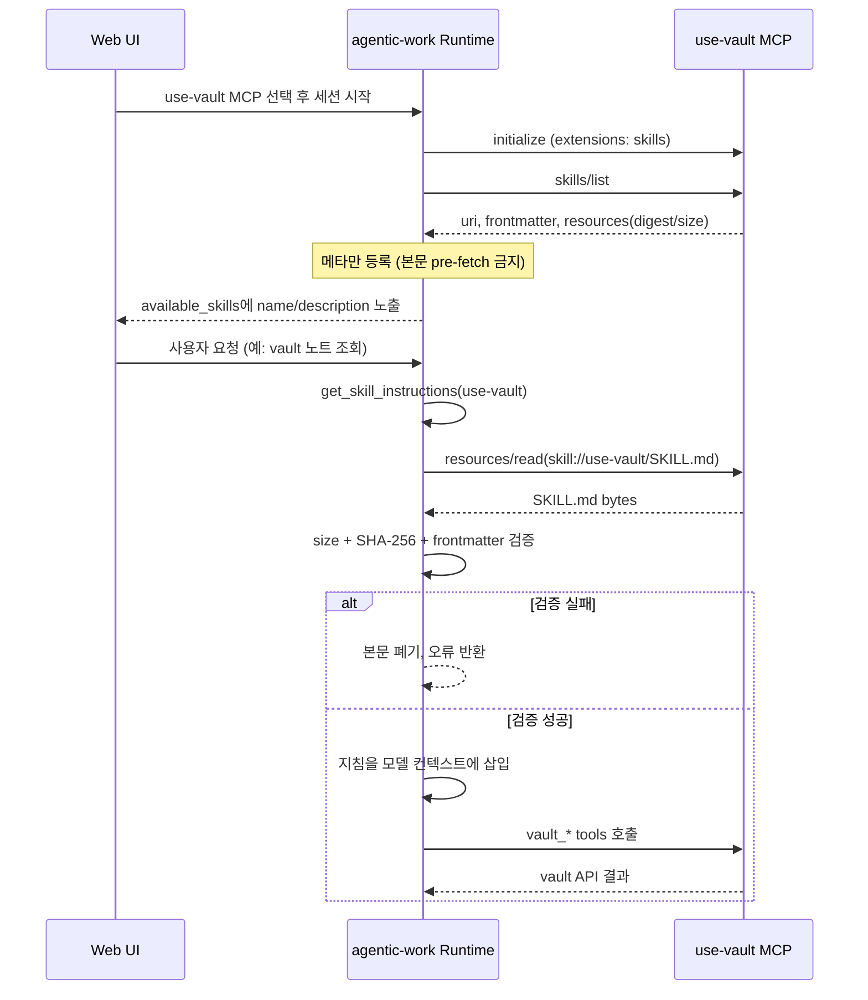

# Skills over MCP

use-vault MCP에 Agent Skills를 실어 보내고, agentic-work Runtime이 이를 소비하는 설계하고 구현합니다.

관련 코드:

- 서버: `ob-note/MCP/use-vault/` (`vault_skills.py`, `skills/use-vault/SKILL.md`)
- 클라이언트: `runtime_agent/langgraph/mcp_skills.py`, `skill.py`, `chat.py`
- 이전 로컬 스킬 `runtime_agent/langgraph/skills/my-vaults/` 는 **삭제됨** (아래 2절은 이력)

---

## 1. Skills over MCP란

### 1.1 한 줄

MCP 서버가 도구와 함께 **Agent Skill**(`SKILL.md` + 지원 파일)을 게시하고, 클라이언트가 필요할 때만 지침을 읽어 모델 컨텍스트에 넣는 공식 확장입니다.

### 1.2 스펙

| 항목 | 값 |
| --- | --- |
| SEP | [SEP-2640](https://modelcontextprotocol.io/seps/2640-skills-extension) (Final) |
| Extension id | `io.modelcontextprotocol/skills` |
| Spec stage | Beta ([ext-skills](https://github.com/modelcontextprotocol/ext-skills)) |
| Overview | [modelcontextprotocol.io/extensions/skills/overview](https://modelcontextprotocol.io/extensions/skills/overview) |

서버는 `resources` capability와 함께 extensions에 skills를 선언합니다.

```json
{
  "capabilities": {
    "resources": {},
    "extensions": {
      "io.modelcontextprotocol/skills": {
        "directoryRead": false
      }
    }
  }
}
```

프로토콜 메시지:

1. **`skills/list`** — skill 목록 + frontmatter + 파일 매니페스트(digest/size)
2. **`skills/get`** — URI로 단일 skill 엔트리
3. **`resources/read`** — `skill://…/SKILL.md` 및 지원 파일 본문
4. (옵션) **`resources/directory/read`** — `directoryRead: true`일 때

Skill 파일 형식은 [Agent Skills](https://agentskills.io/specification)와 동일합니다. MCP는 **전송·발견·무결성**만 정의합니다.

### 1.3 동작 flow

핵심은 **progressive disclosure**: 연결·목록 단계에서는 메타(이름·설명·digest)만 주고, 본문(`SKILL.md`)은 에이전트가 그 skill이 필요할 때만 읽습니다. 호스트는 읽은 바이트를 listing에 있던 digest/size/frontmatter와 대조한 뒤에야 모델 컨텍스트에 넣습니다.



단계 요약:

| 단계 | 누가 | 무엇을 |
| --- | --- | --- |
| 1. 연결 | Host ↔ MCP | `initialize`로 skills extension 확인 |
| 2. 발견 | Host → MCP | `skills/list` — 카탈로그·매니페스트만 |
| 3. 노출 | Host → 모델 | system prompt에 **description**만 (`<available_skills>`) |
| 4. 필요 시 로드 | 모델 → Host | `get_skill_instructions` |
| 5. 본문 조회 | Host → MCP | `resources/read(uri)` |
| 6. 검증 | Host | size · digest · frontmatter 일치 시에만 사용 |
| 7. 실행 | 모델 → MCP | skill 지침에 따라 `vault_*` 등 도구 호출 |

identity는 skill **이름만**이 아니라 **(MCP 서버 + skill URI)** 입니다. 같은 `name`이 다른 서버에서 와도 서로 다른 skill로 취급합니다.

### 1.4 왜 필요한가

도구 이름/설명만으로는 multi-step 워크플로(폴더 규약, 문체, deep link, 이미지 규칙 등)를 담기 어렵습니다. Skill을 서버에 두면:

- 도구와 지침이 **함께 배포·갱신**됩니다
- 호스트는 description만 먼저 보고, 필요할 때 `SKILL.md`를 로드합니다 (progressive disclosure)
- 사용자/에이전트마다 로컬 skill 복사본을 유지하지 않아도 됩니다

### 1.5 SDK / 호스트 지원 (조사 시점)

| 구현 | 상태 |
| --- | --- |
| TypeScript SDK v2.4.0+ | `ext/skills` (`loadSkills` / `SkillsClient`) |
| C# SDK v2.4.0 | `ModelContextProtocol.Extensions.Skills` (experimental) |
| Rust rmcp 3.9+ | beta |
| Ruby SDK 1.9.0 | beta |
| FastMCP (Python) 4.2 | experimental `SkillCatalogProvider` |
| Python 공식 SDK (`mcp`) | PR merge, **미출시** (2.1.1에는 헬퍼 없음) |
| Claude / Claude Code | public beta (Code v2.1.331+) |
| Cursor | client matrix상 미지원 (자체 host는 별도 구현) |

참고:

- [Claude 발표](https://claude.com/resources/articles/skills-over-mcp-tasks-and-more)
- [Claude Code MCP skills](https://code.claude.com/docs/en/mcp#use-skills-from-mcp-servers)
- [implementations.md](https://github.com/modelcontextprotocol/ext-skills/blob/main/docs/implementations.md)

### 1.6 이 레포의 선택

use-vault는 이미 공식 SDK의 `MCPServer` + `Apps` Extension을 씁니다. Prefect FastMCP로 이전하지 않고, `mcp.server.extension.Extension` + `MethodBinding`으로 SEP-2640을 **직접 구현**합니다 (`vault_skills.py`). Python SDK에 Skills가 출시되면 그 헬퍼로 교체할 수 있습니다.

---

## 2. my-vaults가 어떻게 동작했는지 (통합 전)

agentic-work Runtime에 **로컬 파일 스킬**로 번들되어 있었고, use-vault MCP와 **이중 경로**로 같은 vault API를 쳤습니다.

### 2.1 디렉터리

```text
runtime_agent/langgraph/skills/my-vaults/
├── SKILL.md
├── config.json
└── scripts/
    ├── read_vault.py
    ├── write_vault.py
    └── lib_vault.py
```

UI 카탈로그: `application/skills.list`에 `my-vaults` 등록.

### 2.2 SKILL.md

frontmatter:

```yaml
name: my-vaults
description: ob-note(Obsidian형 vault)에 저장된 마크다운 노트를 …
```

핵심 규칙:

- 기본 계정 `kyopark2014@gmail.com` (`config.json`의 `user_id`)
- cwd가 불안정하므로 `$WORKING_DIR/skills/my-vaults/scripts/...` 절대 경로 호출
- use-vault MCP가 켜져 있으면 **MCP 도구 우선**, 스크립트는 폴백
- 노트 본문: YAML frontmatter 금지, `# 제목` 시작, 카테고리 폴더 필수
- 합니다체, deep link `url`, 이미지는 vault 상대경로 (`--embed-images`)

### 2.3 config.json

```json
{
  "ob_docs_url": "https://vault.my-agentic-ai.click",
  "region": "us-west-2",
  "project_name": "ob-note",
  "user_id": "kyopark2014@gmail.com"
}
```

### 2.4 스크립트

에이전트 호출 예:

```bash
SCRIPTS="$WORKING_DIR/skills/my-vaults/scripts"
python "$SCRIPTS/read_vault.py" tree
python "$SCRIPTS/write_vault.py" write Meeting/Note.md --content "# Title\n\n본문"
```

| 스크립트 | 역할 |
| --- | --- |
| `read_vault.py` | health / tree / list / read / search / graph / backlinks |
| `write_vault.py` | write / append / upload / embed-images / mkdir / rename / delete / rebuild |
| `lib_vault.py` | VaultAgent HMAC 인증, deep link, 이미지 임베드 |

`lib_vault.resolve_user_id()`는 CLI → env → `config.json` `user_id` → `local-dev` 순입니다.

### 2.5 Runtime 로딩 경로

```text
Dockerfile COPY → /app/skills/my-vaults/
SkillManager._discover(skills/*/SKILL.md) → registry
UI skill_list → get_skill_info → <available_skills>
에이전트 → get_skill_instructions("base", "my-vaults")
         → bash/execute_code로 scripts 실행
         → vault.my-agentic-ai.click /api/...
```

핵심 코드 (`runtime_agent/langgraph/skill.py`):

```python
def _discover(self, skills_dir: str):
    for entry in os.listdir(skills_dir):
        skill_md = os.path.join(skills_dir, entry, "SKILL.md")
        if os.path.isfile(skill_md):
            meta, instructions = self._parse_skill_md(skill_md)
            self.registry[skill.name] = Skill(...)
```

`chat.create_agent`는 MCP 도구와 skill 도구를 함께 붙입니다. use-vault가 선택되면 `append_tool_guidance_to_prompt`가 `vault_*` + `actor_id` 사용을 강제합니다.

### 2.6 문제

| 경로 | 위치 | 내용 |
| --- | --- | --- |
| MCP tools + `INSTRUCTIONS` | `ob-note/MCP/use-vault` | 도구 + 짧은 규칙 |
| harness skill | `ob-note/skills/use-vault` (삭제됨) | Open Agent용 짧은 SKILL |
| Runtime skill | `agentic-work/.../my-vaults` (삭제됨) | 상세 규칙 + 스크립트 |

지침이 삼중으로 갈라져 갱신이 어려웠습니다. 현재는 `MCP/use-vault/skills/use-vault/SKILL.md` 단일 소스이며, harness S3 업로드도 이 경로를 사용합니다.

---

## 3. 통합 설계 (Skills over MCP)

### 3.1 목표 흐름

```text
UI: mcp.list 에 use-vault 선택
        │
        ▼
agentic-work Runtime
  ├─ MCPAdapter → vault_* tools
  └─ mcp_skills.discover → skills/list
        │
        ▼
use-vault MCP (ob-note AgentCore)
  ├─ Apps extension (ui://vault/viewer.html)
  ├─ Skills extension (skill://use-vault/SKILL.md)
  └─ vault_* → vault HTTP API
```

- vault 워크플로 **단일 소스**: `ob-note/MCP/use-vault/skills/use-vault/SKILL.md`
- use-vault MCP만 선택해도 skill이 available_skills에 자동 포함
- 로컬 `my-vaults` 디렉터리와 `skills.list` 항목은 **제거됨**

### 3.2 서버

`vault_skills.py`:

- `Extension.identifier = "io.modelcontextprotocol/skills"`
- `skills/list`, `skills/get` MethodBinding
- `TextResource`로 `skill://use-vault/...` 제공
- 디렉터리 바이트로 SHA-256 digest / size 매니페스트 계산

`mcp_server_use_vault.py`:

```python
mcp = MCPServer(
    name="use-vault",
    instructions=INSTRUCTIONS,  # 짧게 유지
    extensions=[apps, skills],
)
```

`skills/list` 실제 응답 예 (로컬 카탈로그 기준, 본문 없음):

```json
{
  "resultType": "complete",
  "ttlMs": 300000,
  "cacheScope": "public",
  "skills": [
    {
      "uri": "skill://use-vault/SKILL.md",
      "frontmatter": {
        "name": "use-vault",
        "description": "ob-note(Obsidian형 vault)에 저장된 마크다운 노트를 조회·검색·생성·수정합니다. 사용자가 \"vault\", \"내 노트\", \"ob-note\", \"위키링크\", \"백링크\", \"노트 찾아줘\", \"메모 저장\", \"vault에 적어줘\", \"지식베이스\" 등을 요청할 때 사용합니다."
      },
      "resources": [
        {
          "uri": "skill://use-vault/SKILL.md",
          "digest": "sha256:4428922db82bc113bbce567b7a6e39e7e69ba24a9726e9d7386af0b8c00ba989",
          "size": 8705
        }
      ]
    }
  ]
}
```

- envelope: `resultType` / `ttlMs`(5분) / `cacheScope`
- skill entry: `uri` + YAML `frontmatter` 전체 + `resources` 매니페스트(URI·digest·size)
- 현재 번들은 `SKILL.md` 한 파일이라 `resources` 항목도 1개. `nextCursor` 없음
- `digest`/`size`는 파일 바이트가 바뀌면 함께 바뀜

### 3.3 클라이언트 (agentic-work)

`mcp_skills.py` (SEP-2640 host MUST):

1. 선택된 서버 connection으로 streamable HTTP(+SigV4) 세션 오픈
2. `server_capabilities.extensions`에 skills가 있으면 `skills/list`만 호출 (**파일 pre-fetch 금지**)
3. 메타만 등록: `name` / `description` / `uri` / `frontmatter` / `resources`(digest·size) / `connection`
4. `get_skill_instructions` 시 `resources/read(uri)` → **size·SHA-256 digest·frontmatter 필드 단위 검증** 후 본문 사용
5. 검증 실패 시 본문을 쓰지 않음 (`ValueError` → 도구 오류 메시지)

`skill.py`:

- `Skill.origin = mcp:<server>`, `uri`, `connection`, `frontmatter`, `resources` 보관
- 동명 충돌 시 silent replace 금지 → registry 키를 `{server}:{name}`으로 분리
- 로드 헤더에 `SKILL_IDENTITY={server}+{uri}` 표기

`chat.create_agent`:

- MCP 도구 로딩 직후 `discover_mcp_skills(server_params)` (메타만)
- `get_skill_info(..., mcp_skill_names=...)`에 MCP skill 병합 → description만 system prompt에 노출

### 3.4 Skill 본문 방침

MCP-served `use-vault` skill은 **실행 경로를 MCP tools**로 적습니다 (`vault_read`, `vault_write` …).  
스크립트 CLI는 agentic-work Runtime 경로에서 더 이상 1순위가 아닙니다. my-vaults에 있던 한글체·폴더·deep link·이미지 규칙은 그대로 옮깁니다.

---

## 4. SEP-2640 대비 갭 검토

참조: [vault 공유 노트 — Skills over MCP 요약](https://vault.my-agentic-ai.click/s/uSe3Cs_Q5drQUICrc9e0Bb5f) 및 [SEP-2640](https://modelcontextprotocol.io/seps/2640-skills-extension).

### 4.1 맞는 부분 (서버 / 기본 배선)

- capability `io.modelcontextprotocol/skills` + `resources`
- `skills/list` / `skills/get` + `skill://…` `resources/read`
- list entry에 `uri` / `frontmatter` / digest·size manifest, `resultType`·`ttlMs`·`cacheScope`
- `directoryRead: false` (옵션 미구현은 정상)
- frontmatter `name`/`description`, 폴더명=`use-vault` 일치

### 4.2 갭과 대응

| 우선 | 갭 | 스펙 | 상태 |
| --- | --- | --- | --- |
| **P0** | 연결·listing 시 SKILL.md **eager fetch** | Hosts MUST NOT retrieve files ahead of need | **수정함** — discover는 메타만, 본문은 `get_skill_instructions` |
| **P0** | digest/size/frontmatter 미검증 | 사용 전 SHA-256·size·frontmatter 필드 단위 검증 | **수정함** — `verify_skill_md_bytes` / `load_verified_skill_md(_sync)` |
| **P1** | registry를 `name`만으로 덮어씀 | identity = **server + URI** | **부분** — 충돌 시 `{server}:{name}` 분리 + `SKILL_IDENTITY` 헤더; 승인 UI는 없음 |
| **P1** | 사용자 승인·manifest 바인딩 | 승인(또는 정책)을 URI+digest 세트에 묶고 변경 시 재승인 | **미구현** (Runtime은 MCP 선택으로 암묵 허용) |
| **P2** | `nextCursor` 무시 | pagination | **미구현** (skill 1개라 실질 영향 없음) |
| **P2** | `directoryRead` / `"dynamic"` | 옵션 | **불필요** (현재 정적 번들; `"dynamic"`은 검증 경로만 준비) |
| **P2** | supporting files | manifest 내 URI만 읽고 digest 검증 | **부분** — SKILL.md만 로드; 부속 파일이 생기면 동일 verify 경로 확장 |

### 4.3 핵심 스펙 문장

> Hosts MUST NOT retrieve files ahead of need, including on connection, listing, or approval.

권장(및 현재) 흐름:

1. discover = `skills/list` 메타만 등록
2. `get_skill_instructions` → `resources/read` + digest/size/frontmatter 검증
3. 레지스트리에서 동명 silent replace 금지; identity는 server+URI

### 4.4 범위 밖

- Claude 승인 UX, 조직 on/off
- 스킬 간 precedence/거버넌스
- Enterprise 정책

---

## 5. 검증 체크리스트

1. 로컬/배포 use-vault: `skills/list`에 `use-vault` 엔트리, digest 일치하는 `resources/read`
2. agentic-work: use-vault만 선택 → `<available_skills>`에 use-vault 등장 (**본문 미포함**)
3. `get_skill_instructions(plugin_name="base", skill_name="use-vault")` → lazy `resources/read` + digest 검증 후 본문
4. digest 변조 시 로드 거부 (본문 미사용)
5. vault 요청 시 `vault_*` + actor_id, 한글체·카테고리 폴더 규칙 준수
6. `skills.list` / `skills/my-vaults/` 없음 (디렉터리 삭제 확인)
